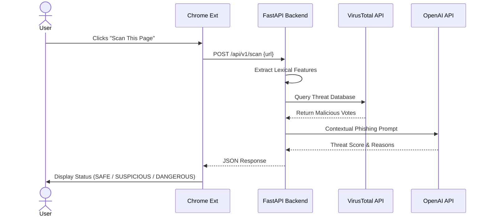

<p align="center">
  
</p>

<h1 align="center">ThreatLens AI</h1>

<p align="center">
  <strong>Multi-signal analysis for suspicious URLs.</strong><br/>
  A prototype Chrome extension and FastAPI service combining URL lexical signals, VirusTotal lookups and AI-assisted contextual analysis.
</p>

<p align="center">
  <a href="https://www.python.org/"></a>
  <a href="https://fastapi.tiangolo.com/"></a>
  <a href="https://developer.chrome.com/docs/extensions/"></a>
  <a href="https://github.com/tracolerd/ThreatLens-AI"></a>
</p>

<p align="center">
  <a href="#project-details">Project details</a> · <a href="#project-setup">Install / run</a> · <a href="#project-architecture">Architecture</a> · <a href="#project-limitations">Security notes</a> · <a href="#creator-developer-maintainer">Creator</a>
</p>

---

<a id="project-details"></a>
<a id="project-architecture"></a>
## 🚀 System Architecture


<a id="project-limitations"></a>
## Security boundary and current limitations

This repository is an educational prototype, not a production-ready security service. Source review of the current implementation identified these important boundaries:

- **No authentication or authorization:** the API does not protect its scan endpoint. Do not expose it to untrusted networks.
- **Broad CORS policy:** the backend allows requests from any origin while also enabling credentials. Restrict this to known UI origins before deployment.
- **Network exposure by default:** running the backend module starts Uvicorn on `0.0.0.0:8000`; use a trusted local environment and explicitly bind to loopback when remote access is not needed.
- **Third-party disclosure:** when API keys are configured, submitted URLs and associated analysis data are sent to VirusTotal and OpenAI. Do not scan private or sensitive URLs unless disclosure is authorized and acceptable.
- **Fallbacks are not a clean verdict:** if OpenAI is not configured, the current service returns a fixed `SUSPICIOUS` fallback score; AI failures also produce a fallback. A missing VirusTotal result must not be interpreted as proof that a URL is safe.
- **Error hygiene:** the current API forwards exception text in HTTP error responses. Sanitize client-facing errors and log diagnostic details securely before broader use.

Treat every result as a triage signal for human review—not a guarantee that a URL is safe or malicious.

## ✨ Core Features

* **Real-time Tab Detection**: Automatically pulls the active URL from your Chrome tab using Manifest V3 APIs.
* **Lexical Feature Extraction**: Analyzes domain structure, IP presence, typosquatting keywords, and URL lengths.
* **VirusTotal Intelligence**: Queries global threat databases for reported domain flags.
* **AI Contextual Analysis**: Leverages LLMs to evaluate subtle phishing patterns and malicious intent.
* **Modern Dark UI**: Lightweight, responsive popup dashboard with clean visual threat indicators.

---

## 🛠️ Tech Stack

| Component | Technology | Description |
|-----------|------------|-------------|
| **Frontend** | HTML5, CSS3, Vanilla JS | Chrome Extension (Manifest V3) |
| **Backend** | Python 3.11+, FastAPI | High-performance API server |
| **Server** | Uvicorn | ASGI web server implementation |
| **External APIs**| OpenAI, VirusTotal | Threat intelligence & LLM reasoning |

---

<a id="project-setup"></a>
## ⚙️ Installation & Setup

### 1. Backend Setup

```bash
# Clone the repository
git clone [https://github.com/tracolerd/ThreatLens-AI.git](https://github.com/tracolerd/ThreatLens-AI.git)
cd ThreatLens-AI/backend

# Create and activate virtual environment
python3 -m venv venv
source venv/bin/activate  # Windows: venv\Scripts\activate

# Install dependencies
pip install -r requirements.txt
```
Environment Variables:
Create a .env file in the backend directory and add your API keys:
```bash
OPENAI_API_KEY=your_actual_openai_api_key
VIRUSTOTAL_API_KEY=your_actual_virustotal_api_key

# Start the Server:
uvicorn main:app --reload
```

### 2. Chrome Extension Setup
Open Google Chrome and navigate to chrome://extensions/.

Enable Developer mode (toggle at the top-right corner).

Click Load unpacked and select the extension/ directory from this project.

Pin ThreatLens-AI to your browser toolbar.

📡 API Endpoint Reference
POST /api/v1/scan

```bash
# Request:
{
  "url": "[https://example-phishing-site.com/login](https://example-phishing-site.com/login)"
}

# Response:
{
  "threat_score": 85,
  "status": "DANGEROUS",
  "reasons": [
    "Domain contains suspicious keyword 'login' with IP redirect.",
    "Flagged by 4 VirusTotal security vendors.",
    "OpenAI detected credential harvesting patterns in URL path."
  ]
}
```

🔒 Security & Privacy Notice
Note: URLs sent to the backend are evaluated transiently and are strictly not stored in any database. Sensitive query parameters are stripped during heuristic extraction to preserve user privacy.

---
---

---

## Creator, Developer & Maintainer

**Created, designed, developed, documented, and maintained independently by [Nurul Faiyaz](https://github.com/tracolerd).**

<p align="center">
  <a href="https://www.facebook.com/faiyaz.888"></a>
  <a href="https://www.instagram.com/tracolerd"></a>
  <a href="https://www.linkedin.com/in/faiyaz-xyz"></a>
  <a href="https://x.com/faiyaz_explores"></a>
  <a href="https://github.com/tracolerd"></a>
  <a href="mailto:scrollfaiyaz@gmail.com"></a>
  <a href="https://nurul-faiyaz.netlify.app/"></a>
</p>

<p align="center">
  <a href="https://www.facebook.com/faiyaz.888">Facebook</a> ·
  <a href="https://www.instagram.com/tracolerd">Instagram</a> ·
  <a href="https://www.linkedin.com/in/faiyaz-xyz">LinkedIn</a> ·
  <a href="https://x.com/faiyaz_explores">X / Twitter</a> ·
  <a href="https://github.com/tracolerd">GitHub</a> ·
  <a href="mailto:scrollfaiyaz@gmail.com">Email</a> ·
  <a href="https://nurul-faiyaz.netlify.app/">Website</a>
</p>

## License

See [LICENSE](LICENSE) for the license terms.

---

<p align="center"><sub>Portfolio catalog · Project 02 of 22 · <a href="https://github.com/tracolerd">Nurul Faiyaz</a></sub></p>
